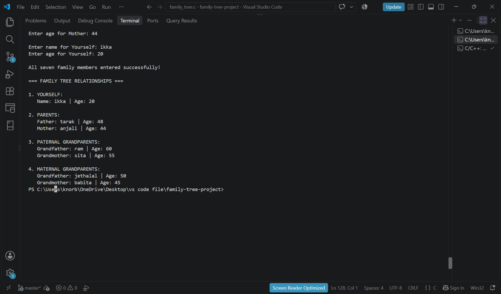
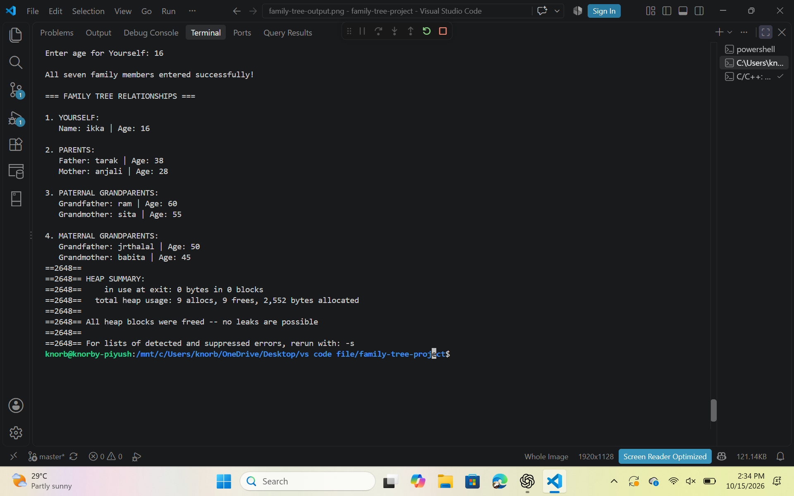

# Family Tree Project in C

## Overview

This project creates and displays a three-generation family tree containing seven people using the C programming language.

## Features

* Stores each family member's name and age.
* Uses structures and pointers to represent family relationships.
* Links parents to their children.
* Displays parents and grandparents.
* Validates family members' ages.
* Frees dynamically allocated memory to prevent memory leaks.

## Technologies Used

* C programming language
* Structures and pointers
* Dynamic memory allocation
* GCC compiler
* Git and GitHub
* Ubuntu and Valgrind

## How to Compile and Run

### Compile and Run on Ubuntu/Linux

Compile the program using GCC:

```bash
gcc family_tree.c -o family_tree -Wall -Wextra -g
```

Run the program:

```bash
./family_tree
```

### Compile and Run on Windows PowerShell

Compile the program:

```powershell
gcc family_tree.c -o family_tree.exe -Wall -Wextra
```

Run the executable:

```powershell
.\family_tree.exe
```

## Memory Leak Testing

The program was tested using Valgrind to check for memory leaks.

Command used:

```bash
valgrind --leak-check=full --show-leak-kinds=all ./family_tree
```

**Result:** Valgrind reported that all heap blocks were freed and no memory leaks were possible.

## Example Output

### Family Tree Program Output



### Ubuntu and Valgrind Output



## Author

Spidy25ug-apu
